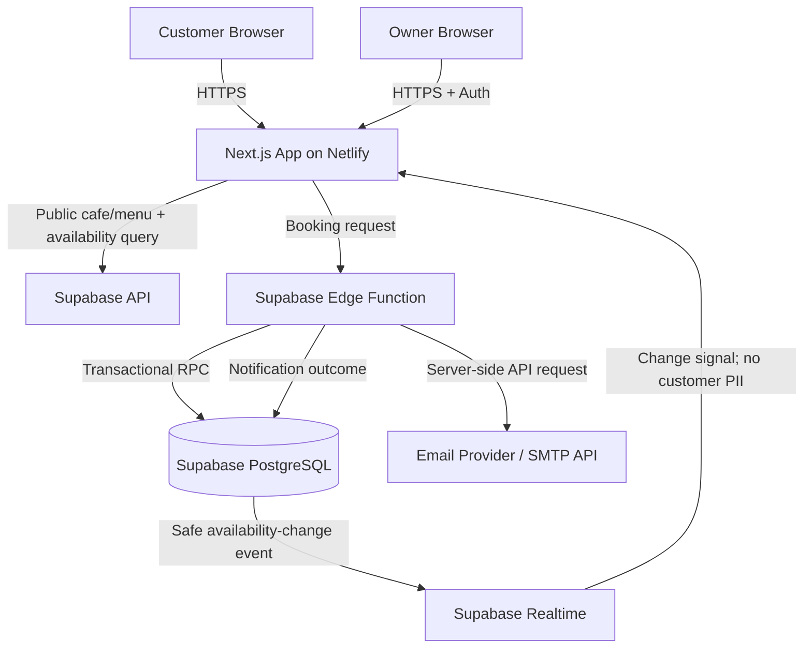

# System Architecture

**Project:** Demo Café Website & Real-Time Table Booking  
**Version:** 1.0  
**Status:** Proposed architecture; verify against the existing prototype before implementation.

## 1. Architecture principles

- Keep the public site fast and mobile-first.
- Treat the database/server as the authority for booking and capacity, never the browser.
- Keep personal booking data private; publish only the minimum information required to display cafe details and availability.
- Validate and assign capacity in one atomic database transaction.
- Separate booking success from email-delivery success.
- Reuse an existing working framework where practical. Do not rewrite the project just to match this document.

## 2. High-level architecture



## 3. Recommended technology stack

First inspect `package.json`, source folders, and current deployment config. If the prototype already uses a stable stack, retain it unless there is a concrete blocker.

For a new implementation:

| Layer | Recommendation | Responsibility |
|---|---|---|
| Frontend | Existing Next.js application (JavaScript unless the repository proves otherwise) | Public cafe page, booking flow, admin UI; preserve the existing App Router or Pages Router |
| Styling | Tailwind CSS v4.x (exact installed patch version must be verified in `package.json`/lockfile) | Responsive UI and design tokens; use the Next.js/PostCSS integration, not the Vite plugin |
| Database | Supabase PostgreSQL | Cafe configuration, inventory, bookings, menus, logs |
| Authentication | Supabase Auth | Owner sign-in |
| Realtime | Supabase Realtime on a safe change-signal table/channel | Inform browsers to re-fetch availability |
| Booking API | Server-side API Route / Supabase RPC | Trusted validation, assignment, conflict control |
| Email | Google/Gmail SMTP via Nodemailer (server-only endpoint) | Customer/owner notification |
| Frontend hosting | Netlify | Preview and deployed website |
| Version control | Git + GitHub | Source history and deployment integration |

GitHub Pages can host static files, but it does not provide the server-side booking transaction or secret email API execution. Keep the backend on Supabase regardless of the frontend host.

## 3A. Existing local development launcher (important)

The user-provided Node.js script uses `child_process.spawn` to run `node_modules/next/dist/bin/next dev --hostname 0.0.0.0`, then rewrites the displayed `0.0.0.0` address in stdout to a detected local IPv4 address. This confirms that the project uses Next.js for local development; it does **not** indicate that Vite is in use, and the wrapper itself is not an Express/API backend.

Rules for assistants working on this project:
- Inspect `package.json`, the exact launcher filename, and npm scripts before changing startup behavior.
- Preserve the existing launcher and its LAN-access behavior unless the user explicitly asks to change it or a reproducible issue requires a change.
- Do not install/configure Vite or add `@tailwindcss/vite`.
- This script starts `next dev`, which is development-only. Do not use it as the production deployment command. Use the existing deployment platform's supported Next.js build/runtime flow.
- Tailwind CSS v4's standard Next.js setup uses the `@tailwindcss/postcss` PostCSS plugin and `@import "tailwindcss"` in the global stylesheet. Inspect current files first; do not blindly overwrite existing config. Official guide: https://tailwindcss.com/docs/installation/framework-guides/nextjs

## 4. Suggested repository layout

Adapt to the existing repository rather than forcing a reorganization.

```text
cafe-booking/
├── docs/
│   ├── PRD.md
│   ├── ARCHITECTURE.md
│   ├── RULES.md
│   ├── DESIGN.md
│   ├── TASKS.md
│   └── MEMORY.md
├── public/
│   └── demo-assets/
├── src/
│   ├── app/ or pages/       # Keep the router pattern already used by this Next.js project
│   ├── components/          # Reusable UI components
│   ├── features/
│   │   ├── availability/
│   │   ├── booking/
│   │   ├── menu/
│   │   └── admin/
│   ├── lib/                 # Supabase client and shared utilities
│   ├── services/             # Typed calls to backend functions
│   ├── types/
│   └── styles/
├── supabase/
│   ├── migrations/
│   └── functions/
│       ├── create-booking/
│       ├── cancel-booking/
│       └── send-booking-notifications/
├── tests/
├── [existing Next.js dev launcher].js  # Preserve actual filename; launches `next dev`
├── postcss.config.mjs                    # Only if this is the current Tailwind v4 config format
├── .env.example
├── .gitignore
└── package.json
```

## 5. Data model

Use migrations for schema changes. Names and types can be adapted to an existing database, but preserve the underlying invariants.

### `cafe_settings`

- `id` (singleton or stable UUID primary key)
- `cafe_name`, `logo_url`, `description`
- `public_address`, `landmark`, `public_phone`, `whatsapp_phone`, `map_url`
- `owner_email` (private; do not expose in public settings payload)
- `timezone` (default `Asia/Kolkata`)
- `opening_hours` (structured JSON or normalized hours table)
- `default_duration_minutes`, `allowed_duration_minutes`, `cleaning_buffer_minutes`
- `seating_mode` (`shared_seating` or `exclusive_table`)
- `is_demo`
- `updated_at`

### `cafe_tables`

- `id` UUID primary key
- `table_code` unique human-readable code (e.g. `T01`)
- `chair_capacity` integer greater than zero
- `is_active` boolean
- `is_out_of_service` boolean
- optional `display_order`, `zone`, and `notes`
- timestamps

### `menu_categories` and `menu_items`

Menu category includes name, sort order, and active state. A menu item includes category ID, name, description, price, currency (INR for this project), image URL, active state, and timestamps. Only active menu records are public.

### `bookings`

- `id` UUID primary key and a non-guessable/public-safe `booking_reference`
- `customer_name`, `customer_email`, optional `customer_phone`
- `party_size` positive integer
- `start_at`, `end_at` timestamps (store consistently; use UTC in DB)
- `status` (`confirmed`, `cancelled`, `completed`, `no_show`)
- `seating_mode_snapshot` for audit/debugging if useful
- `created_at`, `updated_at`, optional cancellation metadata

### `booking_tables`

- `booking_id` foreign key
- `table_id` foreign key
- `seats_allocated` positive integer
- primary key or unique constraint on (`booking_id`, `table_id`)

This join table supports a booking assigned to more than one table, and supports chair-level capacity tracking when shared seating is enabled.

### `availability_events`

A safe signal table for realtime subscriptions. It should contain only an event ID, timestamp, and minimal inventory scope (for example, affected table IDs); never customer name, email, phone, booking reference, or free-form customer data. On receiving a signal, a client calls the trusted availability query again for its selected time range.

### `email_logs`

- `id`, `booking_id`, `recipient_type` (`customer`/`owner`), recipient address (private), provider, status, provider message ID (if available), attempt count, sanitized error, timestamps
- Read/write access restricted to authorized server-side operations and owners.

## 6. Booking and availability algorithms

### Availability query

Input: date/start time, duration, party size, desired table count or auto-select, cafe timezone. Validate input and opening hours. Determine `[start_at, end_at)` using the cafe timezone, then convert to database timestamps. Exclude inactive/out-of-service tables.

For every candidate table, calculate active overlapping allocations:

- `overlap`: existing `start_at < requested_end` and existing `end_at > requested_start`, excluding cancelled/completed bookings as defined by policy.
- In `shared_seating` mode, remaining seats = chair capacity minus seats allocated by all overlapping active bookings. A table is eligible if it has at least one free seat. A group may be assigned to one or multiple eligible tables if the combined allocated seats meet party size and requested table count.
- In `exclusive_table` mode, any overlapping active booking makes that table unavailable for the entire requested interval. Do not present remaining physical chairs as independently bookable on an occupied table.
- Include an optional cleaning buffer by expanding the conflict interval at the policy layer. Document whether the buffer applies before and/or after bookings.

The availability response must contain only public-safe values such as table code, chair capacity, seats remaining, available/partial/unavailable state, and safe descriptive metadata.

### Atomic booking creation

The client submits one request to an Edge Function; it does not insert directly into `bookings`.

1. Validate required fields, email format, party size, date/time, duration, desired table count, and idempotency key.
2. Call a PostgreSQL RPC (e.g. `create_booking_atomic`) that runs inside one transaction.
3. Lock candidate `cafe_tables` rows in deterministic ID order (`SELECT ... FOR UPDATE`) before calculating occupancy. Recheck current bookings while holding the locks.
4. Validate opening hours, seating mode, active state, capacity, requested table count, and overlap rules.
5. Insert the booking and its `booking_tables` assignments in the same transaction.
6. Insert a minimal `availability_events` record in the same transaction.
7. Commit and return a safe confirmation payload with booking reference and assigned table codes.
8. Only after commit, attempt customer and owner email delivery and write separate `email_logs` rows.

A failed email must not cause a retry to create a duplicate booking. Support idempotency on booking submission. Never assume a UI pre-check guarantees that the booking is still available.

### Seat allocation behavior

The prototype's default cafe setting is `shared_seating` to demonstrate remaining-chair tracking. The admin can switch to `exclusive_table`. In shared mode, a table with 4 seats and 2 overlapping allocated seats has 2 seats left; a new party can use those seats only if its party size and requested table selection fit. In exclusive mode, an overlapping booking blocks the full table.

### Realtime behavior

Subscribe to `availability_events` (or use a private authenticated broadcast channel). A received event is only a signal; it is not a source of truth. Re-run the availability query for the currently selected date/time/duration. Unsubscribe on component unmount and avoid duplicate subscriptions.

## 7. API/function boundaries

- `get-public-cafe-settings`: returns only public cafe content, never owner email or private settings.
- `get-available-tables`: validates query inputs and returns safe availability for a chosen time window.
- `create-booking`: validates input, calls `create_booking_atomic`, then triggers notifications.
- `cancel-booking`: owner-protected operation; changes booking status transactionally and emits an availability event.
- `admin-update-inventory`: owner-protected table and settings updates, with validation against active bookings.
- `send-booking-notifications`: server-side only; may be internal to the booking function or a separate function with retry support.

Use trusted server secrets only in Supabase Function secrets or a server-only environment. Never add service-role keys or email secrets to any browser bundle or `NEXT_PUBLIC_*` variable.

## 8. Security and RLS

- Enable RLS on every table exposed through the Supabase API.
- Anonymous visitors may read only published public cafe/menu data and safe table metadata/availability results.
- Anonymous visitors must not be allowed to SELECT customer booking records or email logs, and must not directly INSERT bookings.
- All booking creation goes through the trusted server function and atomic database operation.
- Admin operations require Supabase Auth and a verified owner/admin authorization check in backend logic and RLS.
- Do not trust a role value supplied by the browser. Manage owner role via a safe admin process.
- Keep the email provider API key and Supabase service-role/secret key server-side.
- Validate inputs and rate-limit or otherwise protect public booking endpoints against spam.
- Avoid logging full customer PII or secrets in application logs.

## 9. Deployment and environment

- Frontend: deploy to Netlify from GitHub; use preview deployments for testing.
- Backend: Supabase project, SQL migrations, RLS policies, Edge Functions, Realtime configuration.
- Email: verified sender/provider configuration and server-side secret.
- `.env.example` contains variable names and non-secret placeholders only.
- If the browser initializes Supabase, public config may use `NEXT_PUBLIC_SUPABASE_URL` and `NEXT_PUBLIC_SUPABASE_ANON_KEY`; treat these as public values and protect data through RLS. Keep service-role/secret keys and email-provider credentials server-side or in Supabase Function secrets. Confirm actual variable names in the existing code before changing them.
- Do not commit `.env`, service-role keys, SMTP passwords, or real customer exports.

## 10. Observability and recovery

- Log booking reference and operation result, not unnecessary PII.
- Store email attempt status separately from booking status.
- Add a retry path for transient email failures, designed so retries never duplicate bookings.
- Provide a safe admin indication for failed notifications.
- If realtime disconnects, the UI should continue to query availability and show a reconnect/stale-data state rather than pretending data is live.
